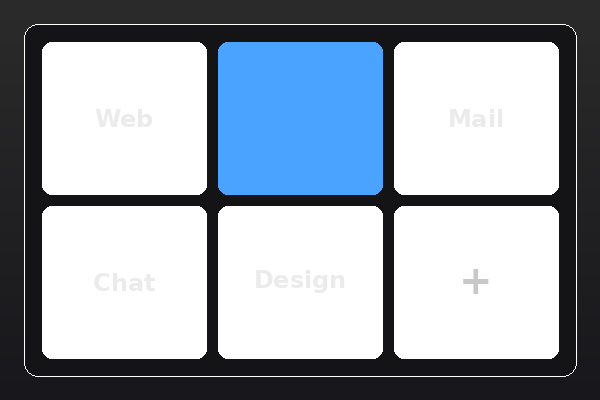

# Cinnamon Desklet Workspace Grid

A Cinnamon desklet that displays a **clickable grid of workspaces**, shows workspace names, and highlights the active workspace.  
This makes it useful for quickly navigating and organizing your desktop environments.

---

## ✨ Features

- 🖥️ Displays a workspace grid directly on the desktop.
- 🖱️ Left-click any workspace in the grid to switch to it.
- ➕ Click the trailing **+** tile to add a workspace (up to 36).
- ✏️ Right-click a tile → **Rename…** to rename that workspace.
- 🗑️ Right-click a tile → **Remove** to delete it, with a confirmation prompt for named workspaces.
- 🏷️ Shows workspace names, and/or an index number.
- 🎨 Highlights the currently active workspace.
- 🔄 Updates live when workspaces are added, removed or renamed anywhere — Expo, the panel applet, or another desklet.
- ⚙️ All settings configurable via **Cinnamon Desklet settings**.

---

## 🛠️ Configuration

You can configure this desklet from the **Cinnamon Desklet settings panel**, which uses [`settings-schema.json`](settings-schema.json) for all definitions.  

### Available options:
- **Layout Mode**: Choose between `auto` (near-square) or `fixed` (rows x cols).
- **Fixed Rows/Columns**: Set the number of rows and columns for the grid in fixed mode.
- **Show Index**: Prefix workspace names with their index number (e.g., "1. Web").
- **Allow adding, removing and renaming workspaces**: Master switch for the editing features. Turn it off for a read-only grid.
- **Show a "+" tile**: Hide the add tile while keeping the right-click menu.
- **Confirm before removing a named workspace**: Skip the prompt if you prefer.
- **Scroll Wheel Behavior**: Use the scroll wheel to switch workspaces by row or column.
- **Style & Layout**: Adjust tile spacing, and desklet width/height via the settings panel.
